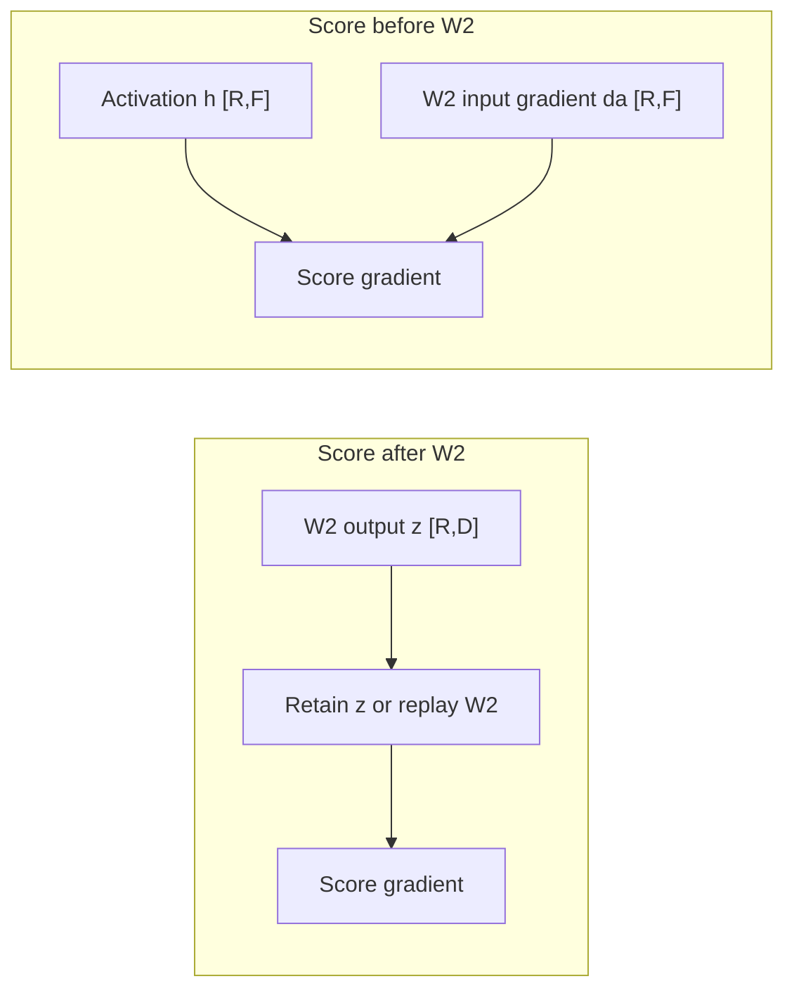
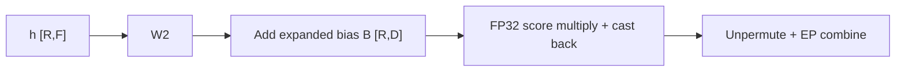
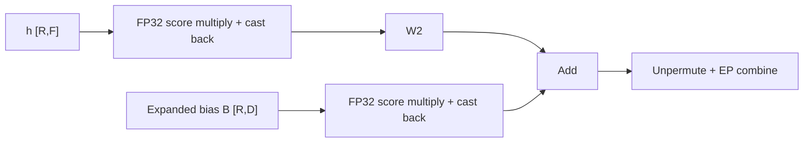
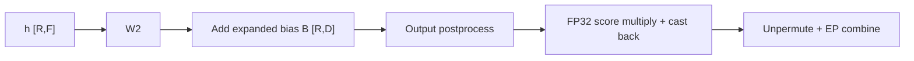

# Router-score absorption

[`RoutedExperts`](moe.py) absorbs DeepEP and HybridEP router scores into W2's
input when `output_postprocess` is absent. Local and AllToAll keep post-expert
scoring; Dist-MoE owns its compute and communication optimizations.

`R` is the number of routed rows on this rank, `D` the model dimension, `F` the
expert intermediate dimension, and `E` the number of local experts. Dispatch
groups rows by expert, so W2 consumes `h_RF` with per-row scores `s_R`.

## Motivation: avoid saving or rebuilding W2's output

Scoring after W2 creates a backward dependency on its unweighted output.
For bias-free experts, with `g_RD` denoting the gradient of the weighted output:

```text
Post-W2: z_RD = W2(h_RF)       y_RD = s_R[:, None] * z_RD
         ds_R = rowsum(g_RD * z_RD)

Pre-W2:  a_RF = s_R[:, None] * h_RF       y_RD = W2(a_RF)
         da_RF = W2_transpose(g_RD)
         ds_R = rowsum(da_RF * h_RF)
```

Post-W2 scoring must retain `z_RD` or run W2 again to recover it. Absorption
computes the score gradient from the pre-scaling activation and W2's input
gradient. W2's forward output is no longer needed for this gradient.



Removing this dependency helps both memory and recomputation, depending on
the remat policy. In the common BF16 path without output postprocessing:

| Execution | Post-W2 scoring | Absorption with saved combine |
| --- | --- | --- |
| No activation remat | Autograd saves W2's output for the score gradient. | That output is unnecessary; autograd still saves the scaled W2 input and scoring operands. |
| W2 saved, as in the default policy | W2's output stays resident for replayed scoring. | The output need not stay resident; the input scaling can be rebuilt cheaply. |
| W2 eligible for recomputation, as in full remat | Reconstructing the score gradient's input requires a W2 forward replay. | W2's forward replay is unnecessary when no other consumer needs its output. |

One BF16 W2 output occupies `2 * R * D` bytes. For `R = 32768` and
`D = 7168`, that is 448 MiB per layer. This is the size of the avoided output
dependency, not a measured reduction in peak memory: live tensors, padding,
load imbalance, and other consumers determine the actual saving. Under no
remat, retaining the scaled input also offsets part of this saving.

Avoiding one W2 forward replay saves approximately `2 * R * D * F` GEMM FLOPs;
the backward GEMMs still run. Scoring moves from width `D` to width `F`, and
rebuilding the scaled input costs a pointwise multiplication. Biased experts
also scale their output bias. These operations do not add a GEMM, but their
cost and the fraction of a full training step saved depend on the model and
policy. These are analytical costs, not step-time measurements.

## Scoring before W2

Without absorption, each expert output is multiplied by its router score:



For a linear W2, scores can instead multiply its input:



Each score multiplication broadcasts scores as `[R, 1]`. The bias branch is
present only for biased experts, such as GPT-OSS. W13's bias is added before
the activation and is not scaled separately.

An expert's stored bias has shape `[E, D]`, whereas the diagram uses a bias
expanded over routed rows:

```text
B_RD[r, :] = b_ED[expert_for_row(r), :]
y_RD       = s_R[:, None] * (W2(h_RF) + B_RD)
           = W2(s_R[:, None] * h_RF) + s_R[:, None] * B_RD
```

[`GptOssGroupedLinear._expand_grouped_bias`](../../gpt_oss/moe.py) constructs
this row-aligned bias using the same expert offsets as grouped GEMM. Scores
therefore scale the selected expert's bias for each row, not the expert axis.
Tail padding after the final expert offset receives zero bias. Padding within
an expert's offset range receives that expert's bias before score scaling.

## Output postprocessing

A postprocess such as expert-output normalization need not commute with score
multiplication. DeepEP and HybridEP retain post-expert scoring when it is
configured:



Thus `s * output_postprocess(W2(h) + B)` keeps the original operation order.
The combine backend receives weighted outputs in both paths.

## Precision

Score products compute in FP32 and then convert back to the activation dtype.
For example, [`GroupedLinear`](../linear/linear.py) uses type promotion:

```python
scaled_RF = (h_RF * s_R.float().reshape(-1, 1)).to(h_RF.dtype)
```

Leaving the activation operand in its original dtype avoids materializing an
FP32 activation copy that multiplication would otherwise save for backward.
The algebra above holds in exact arithmetic. Casting the scaled input before
W2 changes rounding relative to scoring W2's output; FP32 multiplication does
not guarantee identical BF16 outputs, losses, or gradients.

## Checkpoint dependencies

Absorption removes the score-gradient dependency on W2's output. A replayed
combine would still need its input, so DeepEP and HybridEP wrap all of
`combine_tokens`, including unpermute, in a SAVE region. Combine backward
uses routing metadata rather than expert-output values. DeepEP retains the
unpermute's `R` int64 indices (`8R` bytes, or 256 KiB at `R = 32768`) plus its
opaque dispatch handle. HybridEP retains its opaque dispatch handle, whose
storage is backend-specific. Saving combine does not mean retaining no state.

Dispatch still follows `ep_communication`: full remat replays dispatch,
whereas the default policy saves it. Saving combine also avoids its forward
communication replay; backward communication still runs.

Scores are supplied by replayed dispatch/permutation or retained dispatch
outputs. The optimized combine does not consume scores. W2 follows its
configured remat policy, and the GPT-OSS bias addition follows the same
`grouped_mm` decision rather than an independent bias policy. Replaying even a
cheap bias addition after a saved matmul would retain the matmul's full routed
output; saving both avoids this dependency. A real dtype conversion or an
output postprocess (which also disables absorption) still needs W2's output:
with W2 saved it stays resident, and under full remat the W2 GEMM and bias
addition replay. In the common BF16 case without a postprocess, W2's output
is neither retained nor rebuilt. Quantized projections may have additional
saved tensors and recomputation inside their own implementation.

Without activation remat, GPT-OSS's bias scaling saves the expanded `[R,D]`
bias for its score gradient. The bias branch can therefore offset the avoided
W2-output storage. With remat, this expanded bias can be rebuilt from the
per-expert parameter and offsets; it does not require replaying W2.
